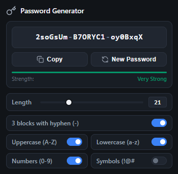

# Secure Password Generator (Chrome Extension)

[](LICENSE)
[](manifest.json)
[](https://developer.mozilla.org/en-US/docs/Web/API/Web_Crypto_API)
[](_locales)

A lightweight, modern, and cryptographically secure Google Chrome extension (Manifest V3) that generates random, customizable passwords with block formatting, instant clipboard copy, and automatic browser language detection.

<p align="center">
  
</p>

---

## 🌟 Key Features

- **Optimized Default Format**: Generates a **21-character** password partitioned into **3 equal 7-character blocks** separated by hyphens (e.g., `dIffikA-nyfkuxB-6bewfoC`). Adjusting to 18 characters produces balanced 6-6-6 sequences like `dIffik-nyfkux-6bewfo`.
- **Automatic Language Detection (i18n)**:
  - Dynamically detects and follows your browser's language setting using native `chrome.i18n`.
  - Ships with built-in translations for **English (`en`)** and **Portuguese (`pt` / `pt_BR`)**, and can be easily extended with more locales.
- **Customizable Security Options**:
  - **Numbers** (`0-9`)
  - **Special Characters / Symbols** (`!@#$%&*+-_=?`)
  - **Uppercase & Lowercase Letters** (`A-Z`, `a-z`)
  - **Split into 3 blocks with hyphens** (toggleable anytime)
  - **Length control**: Interactive slider and synchronized numeric input from 6 to 64 characters.
- **One-Click Instant Copy**:
  - Dedicated "Copy" button with visual feedback (`Copied! ✓`).
  - Click directly anywhere on the password card to copy.
  - Floating toast notification confirming the action.
- **Real-Time Generation**:
  - Click "New Password" for instant generation.
  - Updates automatically whenever you adjust sliders or toggle options.
- **Cryptographic Security**:
  - Powered by `window.crypto.getRandomValues()` with unbiased rejection sampling (eliminates modulo bias).
  - Shuffled using an in-place Fisher-Yates cryptographic routine.
  - Live password strength indicator and entropy estimator (Weak, Fair, Strong, Very Strong).
- **Settings Persistence**:
  - Automatically remembers your preferred settings via `chrome.storage.sync` (or `localStorage` fallback).
- **100% Offline & Privacy-Focused**:
  - No remote server requests, no tracking, and no external dependencies. Everything runs locally in your browser.

---

## 🚀 How to Install in Google Chrome

1. Clone or download this repository:
   ```bash
   git clone https://github.com/your-username/passwd-gen.git
   ```
2. Open **Google Chrome** and navigate to:
   ```text
   chrome://extensions/
   ```
3. Enable **Developer mode** using the toggle switch in the top-right corner.
4. Click the **Load unpacked** button in the top-left corner.
5. Select the project directory (`passwd-gen`).
6. Pin the extension to your Chrome toolbar for quick one-click access!

---

## 📂 Project Structure

```
passwd-gen/
├── assets/
│   └── preview.png          # Screenshot preview of the extension
├── _locales/
│   ├── en/
│   │   └── messages.json    # English translations (default)
│   ├── pt/
│   │   └── messages.json    # Portuguese translations
│   └── pt_BR/
│       └── messages.json    # Portuguese (Brazil) translations
├── icons/
│   ├── icon-16.png          # 16x16 icon
│   ├── icon-48.png          # 48x48 icon
│   └── icon-128.png         # 128x128 icon
├── generate_icons.py        # Python script to generate crisp PNG icons
├── manifest.json            # Manifest V3 extension configuration
├── popup.html               # Semantic HTML5 popup interface
├── popup.css                # Polished theme (Dark & Light support)
├── popup.js                 # Cryptographic logic, i18n, and UI interactions
├── LICENSE                  # GNU General Public License v3.0
└── README.md                # Project documentation
```

---

## 🌍 Adding New Languages

To add a new language:
1. Create a new folder under `_locales/<locale_code>/` (e.g. `_locales/es/` for Spanish).
2. Create a `messages.json` file inside that folder copying the keys from `_locales/en/messages.json`.
3. Provide the translations for the `message` values.
4. Reload the extension in `chrome://extensions/`.

---

## 🤖 AI Disclosure

This project was developed with assistance from Google Antigravity, an AI-powered development environment.

AI assistance was used during the development process, including code generation, implementation suggestions, debugging, and code refinement.

---

## 📜 License

This project is licensed under the **GNU General Public License v3.0 (GPL-3.0)**. See the [LICENSE](LICENSE) file for details.
